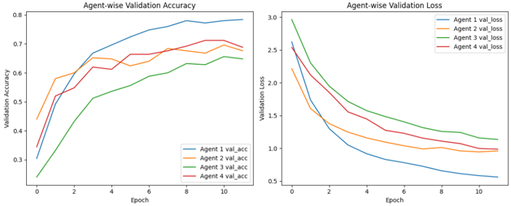
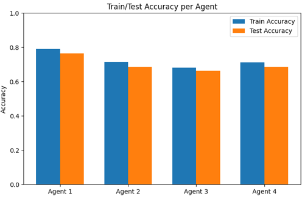
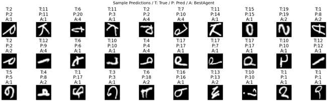

# Adaptive Multi-Agent Classification System

A NOTC-inspired multi-agent classification system in which multiple neural network agents specialize in different regions of the input space and adaptively handle difficult or unfamiliar samples.

The system was evaluated on the EMNIST Letters dataset using four heterogeneous neural network agents.

## Overview

Traditional single-model classifiers may struggle with samples that are rare, ambiguous, or difficult to classify.

This project explores a multi-agent approach in which multiple neural network models cooperate to perform classification.

The system is inspired by the **Novelty-Organizing Team of Classifiers (NOTC)** framework.

The main idea is:

- Multiple agents use different neural network architectures.
- Each agent learns different characteristics of the data.
- Samples confidently classified by existing agents are considered covered.
- Samples that cannot be classified with sufficient confidence are treated as difficult or novel.
- New agents can be introduced to specialize in those samples.
- During inference, the prediction from the most confident agent is selected.

## Dataset

The experiment uses the EMNIST Letters dataset.

EMNIST Letters contains grayscale handwritten English characters from 26 classes (A to Z).

### Preprocessing

- Images are normalized to the range `[0, 1]`.
- Images are reshaped to match the neural network input format.
- Labels are converted to the range `0-25`.

## 1. Problem Description

The goal of this project was to develop a multi-agent classification system capable of handling difficult and unfamiliar input patterns more flexibly than a single classifier.

Instead of relying on one neural network, the system uses multiple agents with different architectures.

Each agent can specialize in different characteristics of the input data.

When none of the existing agents can classify a sample with sufficient confidence, the system can introduce another agent and train it on those difficult examples.

This allows the classifier pool to adapt according to the complexity of the data.

## 2. Methodology and Experimental Setup

### 2.1 Multi-Agent Architecture

Four neural network architectures were used as classification agents.

Each model was designed differently so that the agents could learn different representations of the same dataset.

### Agent 1 — CNN

Designed to focus on local spatial features.

```text
Conv2D(16, 3×3) - ReLU
→ MaxPool(2×2)
→ Conv2D(32, 3×3) - ReLU
→ MaxPool(2×2)
→ Flatten
→ Dense(64) - ReLU
→ Dropout(0.3)
→ Dense(26) - Softmax
```

**Loss Function:** Sparse Categorical Crossentropy  
**Optimizer:** Adam

### Agent 2 — Large-Kernel CNN

Designed to capture more global spatial patterns using larger convolution kernels.

```text
Conv2D(8, 7×7) - ReLU
→ MaxPool(3×3)
→ Conv2D(16, 5×5) - ReLU
→ Flatten
→ Dense(64) - ReLU
→ Dropout(0.3)
→ Dense(26) - Softmax
```

**Loss Function:** Sparse Categorical Crossentropy  
**Optimizer:** Adam

### Agent 3 — MLP

Designed to learn global features from flattened image inputs.

```text
Flatten
→ Dense(256) - ReLU
→ Dropout(0.3)
→ Dense(128) - ReLU
→ Dropout(0.3)
→ Dense(26) - Softmax
```

**Loss Function:** Sparse Categorical Crossentropy  
**Optimizer:** Adam

### Agent 4 — Regularized MLP

Uses batch normalization and stronger dropout for improved regularization.

```text
Flatten
→ Dense(256) - ReLU
→ BatchNorm
→ Dropout(0.4)
→ Dense(128) - ReLU
→ BatchNorm
→ Dropout(0.4)
→ Dense(26) - Softmax
```

**Loss Function:** Sparse Categorical Crossentropy  
**Optimizer:** Adam

## 2.2 NOTC-Inspired Training Strategy

The training procedure was designed to approximate the adaptive specialization concept of NOTC.

### Initialization

The system begins with an initial set of samples.

```text
Initial samples: 10,000
```

The samples are divided among the agents so that each agent begins training on a different subset of the data.

### Incremental Assignment

The remaining data is processed incrementally in batches.

```text
Batch check size: 200
```

For each batch:

1. Every active agent predicts the samples.
2. The confidence of each prediction is evaluated.
3. Samples with confidence greater than or equal to `0.7` are considered covered.
4. Samples that are not confidently classified by any agent are treated as difficult or novel samples.

```text
Confidence threshold: 0.7
```

### Novelty Handling

If none of the current agents can confidently classify the remaining samples, a new agent can be created and trained on those examples.

The maximum number of agents used in this experiment was:

```text
Maximum agents: 4
```

This mechanism allows newly introduced agents to specialize in difficult regions of the input space.

### Fine-Tuning

Once the maximum number of agents has been reached, remaining uncovered samples are used to further train the agent with the highest confidence.

This prevents the system from continuously expanding the number of models.

### Inference

During evaluation, every agent predicts the input sample.

The final prediction is selected from the agent with the highest confidence.

```text
Input
  ↓
Agent 1 ── Confidence
Agent 2 ── Confidence
Agent 3 ── Confidence
Agent 4 ── Confidence
  ↓
Select highest-confidence prediction
  ↓
Final Classification
```

## 2.3 Training Configuration

| Parameter | Value |
|---|---:|
| Dataset | EMNIST Letters |
| Initial samples | 10,000 |
| Incremental batch size | 200 |
| Confidence threshold | 0.7 |
| Epochs | 12 |
| Training batch size | 64 |
| Maximum agents | 4 |

The experiment used fixed random seeds to improve reproducibility.

## 3. Results

The system was evaluated using both per-agent performance and overall multi-agent classification accuracy.

### Validation Performance

All four agents showed improvement during training.

Agent 1 achieved the highest validation performance, reaching approximately **0.78 validation accuracy** and the lowest validation loss among the four agents.

The other agents also learned successfully, although their performance differed due to their architectures and the subsets of data they encountered.

<p align="center">
  
</p>

### Train and Test Accuracy

| Agent | Train Accuracy | Test Accuracy |
|---|---:|---:|
| Agent 1 | 0.7890 | 0.7646 |
| Agent 2 | 0.7158 | 0.6866 |
| Agent 3 | 0.6807 | 0.6630 |
| Agent 4 | 0.7118 | 0.6870 |

<p align="center">
  
</p>

The overall multi-agent classification accuracy was:

```text
Overall Test Accuracy: 0.7634
```

<p align="center">
  
</p>

The final prediction for each sample was selected from the agent with the highest confidence.

### Agent Specialization

The results showed that different agents were selected for different test samples.

This suggests that the heterogeneous agents learned different characteristics of the handwritten letters and developed some degree of specialization.

The multi-agent system was therefore able to use different classifiers depending on the characteristics of each input sample.

## 4. Discussion

The experiment demonstrates that a NOTC-inspired multi-agent classification system can successfully classify handwritten characters using a heterogeneous set of neural network agents.

One of the main advantages of the approach is architectural diversity.

Because the agents use different neural network structures, they can potentially learn different representations of the same data.

The adaptive mechanism also allows the system to respond to samples that are difficult for the existing classifier pool.

Instead of forcing one model to handle every possible input pattern, additional agents can specialize in difficult regions of the input space.

## 5. Limitations

### Resource Consumption

Increasing the number of agents also increases computational and memory requirements.

Although the experiment limited the system to four agents, a fully dynamic implementation could become increasingly expensive as more agents are introduced.

### Model Redundancy

Not every agent contributes equally to the final system.

Some agents may specialize in only a small portion of the input space, while others may consistently achieve better performance.

This can lead to redundant models and inefficient use of computational resources.

### Data Fragmentation

Because agents receive different subsets of the data during initialization and incremental training, some agents may receive less representative training data than others.

This uneven data exposure can reduce the performance of certain agents.

## 6. Possible Improvements

Possible extensions of this project include:

- More effective criteria for creating new agents
- Dynamic removal of redundant agents
- Improved data assignment between agents
- Better balancing of specialization and generalization
- Testing on more complex datasets
- Comparing the multi-agent system with a strong single-model baseline
- Evaluating how the number of agents affects accuracy and computational cost

## 7. References

- [EMNIST Dataset](https://www.tensorflow.org/datasets/catalog/emnist)
- Vargas, D. V., & Murata, J. (2018). *Novelty-organizing team of classifiers in noisy and dynamic environments*. arXiv:1809.07098
  - https://arxiv.org/abs/1809.07098
